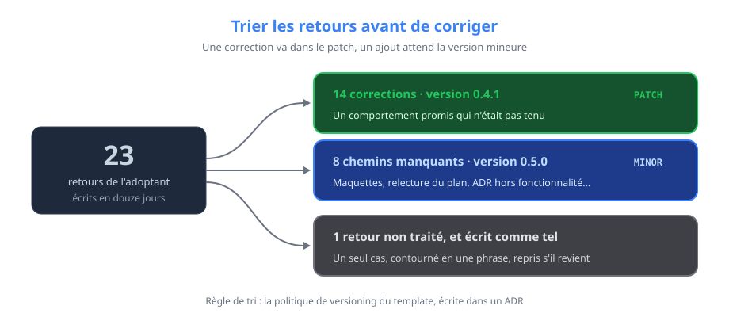
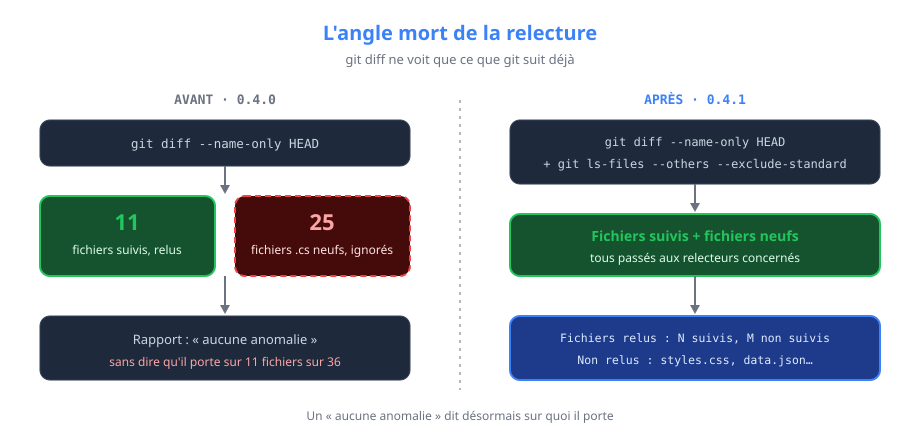
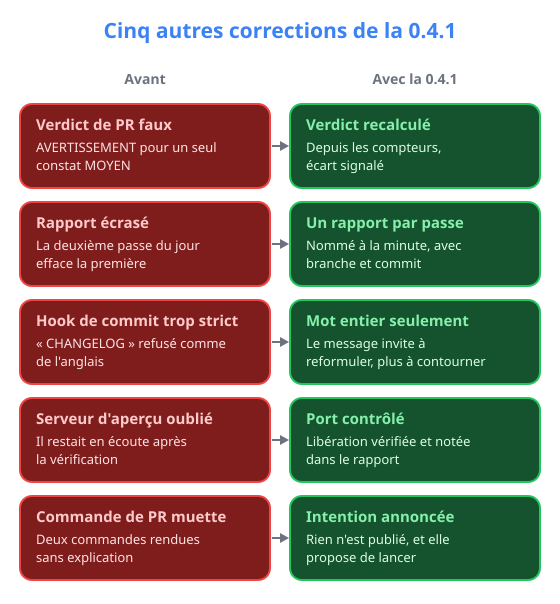
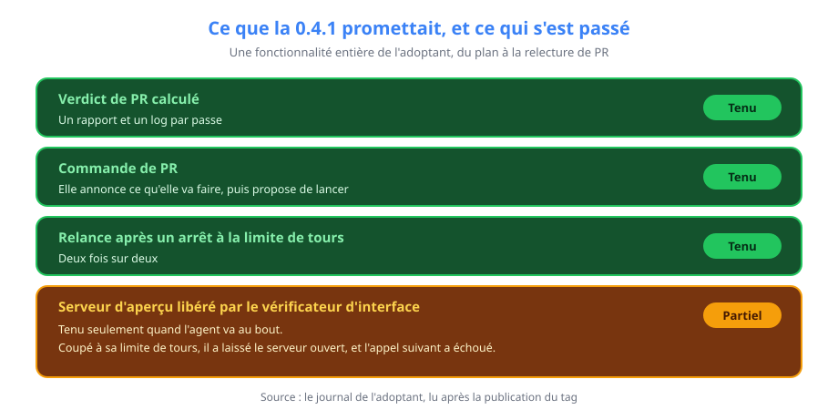

# Mon template Claude Code échouait en silence : ce que la version 0.4.1 corrige, et ce qu'elle repousse

*Publié le 18 novembre 2026 — Nabil Sidhoum, Senior .NET Tech Lead*

---

Depuis l'été, je maintiens un template .NET pour Claude Code : des agents de relecture, des commandes qui enchaînent planification, implémentation et revue, des hooks qui formatent et vérifient. Je l'ai déjà évoqué [quand j'ai rendu ses règles capables d'échouer](/blog/regles-qui-peuvent-echouer). Fin octobre, j'ai publié la version 0.4.0, et une application MAUI Blazor Hybrid l'a adoptée dans la foulée.

En douze jours, cette application a écrit 23 retours dans son dossier de remontées vers le template. En les relisant, j'ai remarqué que la plupart ne décrivaient pas un outil qui plantait, mais un outil qui ne disait rien. Cet article raconte la version 0.4.1 : ce que j'ai corrigé, comment j'ai trié ce qui pouvait attendre, et pourquoi même des tests au vert ne m'ont pas suffi pour la livrer.

---

## Le point commun : le silence

Voici ce que les retours décrivaient, sur une seule fonctionnalité de l'application :

- trois agents se sont arrêtés à leur limite de tours **sans rendre de rapport** ;
- une relecture a ignoré 25 fichiers neufs **sans le dire** ;
- la relecture de PR a rendu un verdict faux, **deux fois** ;
- un hook censé reformater les fichiers n'a rien fait, **sans laisser de trace**.

Aucun de ces défauts ne fait tomber un build. C'est justement ce qui les rend coûteux. Un agent qui s'arrête en route a déjà payé ses lectures : un seul relecteur avait consommé 65 240 tokens avant de s'interrompre. Surtout, une sortie vide ressemble beaucoup à « rien à signaler ». La personne qui lit le rapport n'a aucun moyen de faire la différence, et elle finit par refaire à la main ce que le workflow promettait.

J'utilise ce template pour avancer vite sans surveiller l'outil. Le besoin de la version 0.4.1 se résume en une phrase : **un workflow qui rend ce qu'il annonce, qui dit ce qu'il n'a pas relu, et qui ne dépense pas pour rien.**

---

## Trier avant de corriger

Je n'ai pas tout traité dans la 0.4.1. Le template suit une politique de versioning écrite dans un ADR : une version PATCH ne contient que des corrections sans nouveau contrat (un prompt, un lint, une doc). Tout ce qui ajoute une convention, un agent ou un chemin de délégation est une évolution, donc une version MINOR.

Appliquée aux 23 retours, la règle les répartit en trois groupes :

- **14 corrections** pour la 0.4.1 : un comportement promis qui n'était pas tenu.
- **8 retours reportés à la 0.5.0.** Ce ne sont pas des défauts, ce sont des chemins que le workflow n'a pas encore : il ne sait pas qu'une maquette existe, il ne fait pas relire un plan avant de le soumettre, et il n'offre aucune voie pour un ADR né en dehors d'une fonctionnalité.
- **1 retour non traité**, et je l'ai écrit plutôt que de le passer sous silence : un contrôle qui rougissait sur une citation dans un manifeste. C'est arrivé une fois, à cause de la formulation choisie pendant la session, et une phrase suffisait à le contourner. Je le reprendrai si le cas revient.

Ce tri a une raison concrète. L'adoptant ne télécharge pas une nouvelle version : il recopie des fichiers, un par un, en comparant avec ses modifications locales. Un patch doit pouvoir se reprendre sans changer ses habitudes. Une nouvelle convention mérite son propre plan et sa propre relecture.

---

## Trois problèmes rencontrés

### 1. Le relecteur qui s'arrête sans rien dire

Chaque agent du template a une limite de tours. Quand on confie à un relecteur tout le travail non commité d'une fonctionnalité, il passe ses tours à lire et atteint sa limite avant d'avoir écrit la moindre ligne de rapport. Claude Code le signale bien (« stopped at its turn limit »), mais l'orchestrateur qui l'avait appelé enchaînait comme si de rien n'était.

Le réflexe serait de relever la limite. Je l'avais déjà essayé, sans effet. Une étude menée auparavant laissait même penser que cette limite ne plafonne pas réellement le nombre d'appels d'outils. J'ai donc agi ailleurs :

- **un appel ne couvre jamais plus de vingt fichiers** : au-delà, la relecture est découpée en lots ;
- **ce qu'on fait quand un agent s'arrête est désormais écrit** : depuis la session, une relance par message ; depuis un agent, un nouvel appel en lots deux fois plus petits ;
- **un échec ne passe plus pour un succès** : dans la relecture de PR, une évaluation qui n'a pas abouti donne au mieux un AVERTISSEMENT, jamais APPROUVÉ.

Seul l'agent de planification a vu sa limite passer de 10 à 20 tours, pour une raison simple : un plan ne se découpe pas en lots.

### 2. La relecture qui ne voyait pas les fichiers neufs

Ce défaut-là tenait en une commande. Pour savoir quoi relire, la commande de revue listait les fichiers avec `git diff --name-only HEAD`. Or `git diff` ne voit que les fichiers déjà suivis par git. Une fonctionnalité qui crée de nouvelles classes les laisse donc toutes de côté.

Chez l'adoptant, 25 fichiers `.cs` neufs n'ont pas été relus, et le rapport concluait « aucune anomalie » sur la foi de onze fichiers. La correction ajoute `git ls-files --others --exclude-standard` à la liste. Surtout, le rapport commence maintenant par une ligne qui compte les fichiers suivis et non suivis, et qui nomme ceux que personne n'a relus, une feuille de style ou un JSON par exemple. Un « aucune anomalie » dit désormais sur quoi il porte.

En corrigeant, j'en ai trouvé un second, du même style : trois commandes recopiaient la liste des relecteurs à appeler, et elles en citaient quatre alors que la source en compte six. Elles ne la recopient plus, elles renvoient à la source. Une liste recopiée finit toujours par diverger : je le savais déjà, ce retour me l'a rappelé.

### 3. Le hook qui ne formatait rien, et le correctif qui ne le voyait pas

Après chaque écriture de fichier C#, un hook lance `dotnet format` pour remettre le fichier aux conventions du projet, fins de ligne CRLF comprises. Chez l'adoptant, deux fois, les fichiers sont restés en LF, et personne ne pouvait dire si le hook s'était seulement déclenché.

Ma première correction ajoutait une trace : si le hook échoue, il écrit une ligne dans un log. Elle a été relue, acceptée, mergée. Elle ne marchait pas.

La vérification que j'ai menée avant de poser le tag l'a montré : le hook passait un **chemin absolu** à `dotnet format --include`, qui ignore ce chemin **et sort en code 0**. Il n'y avait pas d'erreur, donc rien à tracer : ni formatage ni log. Ma correction guettait un échec que l'outil ne signalait jamais. Le vrai correctif tient en une ligne : passer un chemin relatif à la racine du projet.

Ce cas montre un trou dans mon process : rien ne m'obligeait à exécuter un hook avant de le livrer. Je l'avais **relu**, jamais **exécuté**. Une relecture vérifie qu'un script dit la bonne chose. Seule une exécution vérifie qu'il la fait. La version 0.5.0 en fera une règle : ce qui s'exécute est exécuté, dans un dossier jetable, avant la PR.

### Les autres corrections, en bref

---

## Des tests au vert ne m'ont pas suffi

La 0.4.1 s'est livrée en cinq lots, chacun avec son plan, sa PR et ses gates : lints, smoke tests, contrôles de structure. Tous étaient verts. Je n'ai pourtant pas posé le tag tout de suite.

Le problème, c'est ce que mes gates vérifient. Pour économiser mon quota, je n'avais pas rejoué les tests de comportement des agents sur cette version. Rien ne vérifiait donc que la version faisait **ce qu'on voulait au départ**. J'ai ajouté deux vérifications, chacune menée dans une session neuve, qui constatent sans rien corriger :

**La vérification du texte, avant le tag.** Elle repart de la liste des retours promis, et non de la liste de ce qui a été produit. Pour chacun des 14 retours, elle vérifie que le template contient bien ce que le plan annonçait, et que cela répond à ce que le retour demandait. Elle a trouvé **deux écarts bloquants que tous les gates laissaient passer** : le hook de formatage décrit plus haut, et la relecture de PR qui ne découpait toujours pas ses lots. Elle a aussi relevé quatre écarts mineurs, comme des schémas de documentation qui décrivaient encore l'ancien comportement. J'ai ajouté un lot avant la publication.

**La vérification du comportement, après le tag.** L'adoptant a mené une fonctionnalité entière avec la 0.4.1, du plan jusqu'à la relecture de PR, et j'ai lu son journal :

Le dernier point, je ne l'ai pas présenté comme un succès. Il est parti dans la 0.5.0, où le lot consacré aux maquettes prendra en charge les tours de cet agent : mesurer d'abord, ne relever la limite que si la mesure le justifie, et mettre un filet chez l'appelant dans tous les cas.

---

## Ce qui attend la 0.5.0, et pourquoi j'ai attendu

Les huit retours reportés sont les plus chers de la série. Sur une fonctionnalité, un écran a été planifié, implémenté et vérifié en quatre passes sans que personne n'ouvre la maquette, qui dessinait quatre écrans : tout a été refait. Un plan qui touchait une barrière de sécurité est arrivé jusqu'à la validation avec deux défauts bloquants, trouvés seulement parce que j'ai demandé une relecture en cours de session. Il manque au workflow des questions qu'une personne attentive poserait d'elle-même avant de dépenser : « y a-t-il une maquette ? », « ce plan a-t-il été relu ? », « cette décision mérite-t-elle un ADR ? ».

J'ai écrit les plans de la 0.5.0 le même jour que ceux de la 0.4.1. Je ne les ai pourtant validés qu'après la vérification du comportement, et ce choix est le mien plutôt que celui de la méthode. Dans mon process, un plan validé devient immuable : les écarts s'ajoutent en fin de document, datés, sans toucher au texte d'origine. Or la 0.4.1 venait de livrer un lot et quatre corrections que son propre plan ne prévoyait pas. Valider la suite avant d'avoir vu la 0.4.1 fonctionner sur un vrai projet, c'était figer des hypothèses que la réalité allait corriger. La fonctionnalité de l'adoptant a effectivement modifié un lot de la 0.5.0 et en a ajouté un autre, avant la première ligne d'implémentation.

---

## Ce que je retiens

Un outil qui plante, on le voit tout de suite. Un outil qui se tait, on le paie plus tard, et souvent deux fois. La 0.4.1 n'ajoute aucune fonctionnalité au template. Elle fait dire à chaque pièce ce qu'elle a fait, ce qu'elle n'a pas fait, et pourquoi.

J'en garde deux réflexes, que j'applique désormais au-delà de ce template. Une sortie vide n'est jamais une preuve d'absence : il faut que l'outil dise sur quoi elle porte. Et un contrôle n'a de valeur que si on l'a vu échouer au moins une fois : ma trace de log, relue et approuvée, n'aurait jamais rien écrit.

---

*Nabil Sidhoum — Senior .NET Tech Lead, Paris. Spécialisé fintech/wealthtech, Clean Architecture, industrialisation d'agents IA en production.*

*GitHub : [nabil-sidhoum](https://github.com/nabil-sidhoum) — Portfolio : [nabil-sidhoum.github.io](https://nabil-sidhoum.github.io)*
