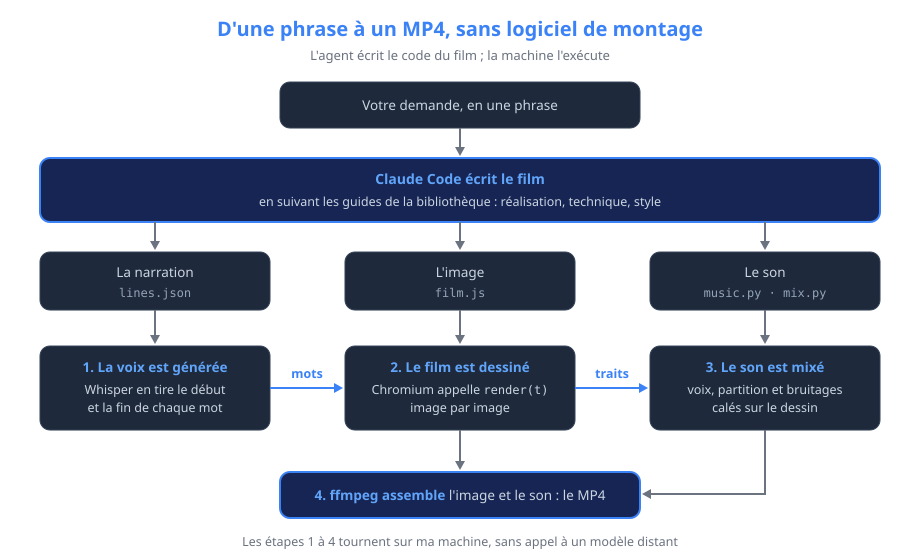
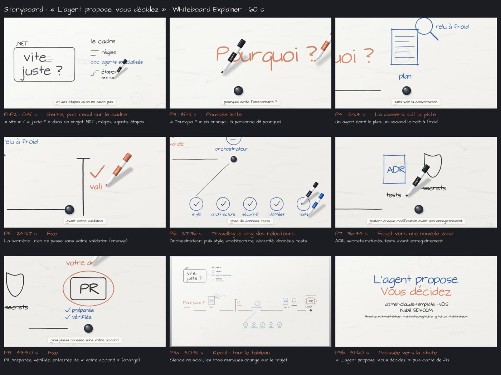
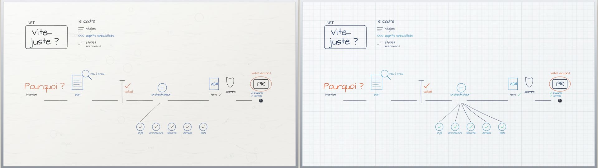

# Une vidéo d'une minute entièrement codée par Claude Code : prérequis, résultat et prix

*Publié le 25 novembre 2026 — Nabil Sidhoum, Senior .NET Tech Lead*

---

J'avais entendu parler de [lemo-opuscar](https://github.com/lemomo-ai/lemo-opuscar), une bibliothèque qui fait réaliser un film à un agent de code. Pas de logiciel de montage, pas d'images générées pour mon film : l'agent écrit le programme qui dessine chaque image, compose la musique, pilote la voix et assemble le tout.

Je venais de poser le tag de la version 0.5 de [mon template .NET pour Claude Code](/blog/template-claude-code-v0-4-1), et je voulais en expliquer le workflow autrement qu'avec une page de documentation. J'ai donc essayé : une minute de vidéo, narrée en français, dans le style d'un tableau blanc.

Voici ce qu'il faut pour en faire autant, la vidéo obtenue, les péripéties, et ce que ça coûterait à l'API.

---

## Comment ça marche

lemo-opuscar s'installe comme un plugin de Claude Code. On demande un film en une phrase, en nommant ou non l'un des 99 styles de la galerie, et l'agent suit les guides de la bibliothèque : réalisation, technique, style.

Un film est une page HTML qui expose une fonction `render(t)`. Un navigateur sans interface l'appelle image par image, ffmpeg assemble, et le son est calculé à part. Pour le mien, cela donne 245 lignes de JavaScript pour le contenu, 154 lignes de Python pour la musique et 144 pour le mixage, plus le moteur du tableau blanc, repris de la bibliothèque et adapté. Je n'en ai pas écrit une seule.



---

## Les prérequis

### Les outils

| Outil | Version demandée | Ce que j'avais |
|---|---|---|
| Node | 20 ou plus | 24, rien à faire |
| ffmpeg | 7 ou plus | absent |
| Python | 3.11 ou plus | 3.8, trop ancien |

Sous Windows, `winget` suffit pour les deux manquants :

```powershell
winget install Gyan.FFmpeg
winget install Python.Python.3.12
```

Vient ensuite le plugin :

```bash
claude plugin marketplace add lemomo-ai/lemo-opuscar
claude plugin install lemo-opuscar@lemolab
```

### La sûreté du plugin

`lemolab` n'est pas une marketplace officielle : mieux vaut lire le projet avant de l'installer, pour s'assurer de ne rien récupérer de malveillant. J'ai demandé cette lecture à Claude avant d'installer les dépendances :

- le manifeste ne déclare aucun hook, donc rien ne s'exécute tout seul dans mes sessions ;
- les paquets Node et Python sont connus ;
- le script d'installation n'installe rien au niveau du système ;
- le téléchargement du modèle vocal contrôle son empreinte.

Rien de suspect, avec deux réserves : le code de rendu n'a pas été lu, et le script d'installation se remet sur la dernière version à chaque exécution. Ce qu'on lit aujourd'hui peut changer demain. J'ai continué en connaissance de cause.

### La voix, sans carte graphique

C'était mon vrai problème de départ. La bibliothèque propose Kokoro, une petite synthèse vocale qui tourne partout et qui a une voix française. Mais mon sujet est truffé de sigles et d'anglicismes, et elle trébuchait dessus. Une transcription automatique de ses répliques, faite par Whisper, donne une idée :

| Texte prévu | Ce que Whisper entendait |
|---|---|
| « Un assistant IA » | « En assistant ya » |
| « La pull request ? » | « La Denpool Request fleut » |
| « chaque commit » | « chaque commis » |

J'ai reformulé ce qui pouvait l'être, puis j'ai cherché une meilleure voix. Là, c'est mon matériel qui a décidé : avec une GeForce 930MX et ses 2 Go de mémoire vidéo, il me fallait un modèle assez petit pour tourner sur le processeur. J'ai donc pris **Qwen3-TTS** dans sa plus petite version (0,6 milliard de paramètres). C'est un modèle ouvert, sous licence Apache 2.0, qui parle français et sait cloner une voix.

Avec une meilleure carte graphique, j'aurais eu deux meilleures options à essayer :

- **la version complète de Qwen3-TTS**, à 1,7 milliard de paramètres, qui clone aussi les voix ;
- **[Orpheus TTS](https://github.com/canopyai/Orpheus-TTS)**, à 3 milliards de paramètres, qui a une préversion française et dont l'installation officielle demande un GPU.

Je n'ai testé ni l'une ni l'autre.

Pour installer Qwen sur le processeur, dans un environnement Python à part :

```powershell
python -m venv C:\qwen-env
C:\qwen-env\Scripts\python -m pip install torch torchaudio --index-url https://download.pytorch.org/whl/cpu
C:\qwen-env\Scripts\python -m pip install -U qwen-tts soundfile
```

Restait à choisir la voix. J'ai comparé la même phrase en trois versions :

| Version | Durée de la phrase | Calcul sur mon processeur |
|---|---|---|
| Kokoro | 8,5 s | quelques secondes |
| Qwen, voix fournie (Aiden, anglaise) | 11,8 s | 89 s |
| Qwen, clone de la voix de Kokoro | 8,6 s | 63 s |

J'ai retenu la troisième : **la voix française de Kokoro, clonée et dite par Qwen.** Une seule réplique de Kokoro sert de référence. Le rythme reste celui de Kokoro, donc le film tient dans sa minute. On peut aussi cloner sa propre voix pour un meilleur rendu, mais ce n'était pas l'objectif de ce test.

```python
modele = Qwen3TTSModel.from_pretrained(
    "Qwen/Qwen3-TTS-12Hz-0.6B-Base", device_map="cpu", dtype=torch.float32)

# La référence : une réplique dite par Kokoro, et sa transcription.
voix = modele.create_voice_clone_prompt(
    ref_audio="kokoro_v03.wav", ref_text=transcription, x_vector_only_mode=False)

audio, frequence = modele.generate_voice_clone(
    text=replique, language="French", voice_clone_prompt=voix)
```

Une minute de calcul par phrase, c'est lent, mais pour onze répliques c'est tout à fait supportable.

---

## Le storyboard

J'ai demandé une durée, une langue, une source (les fichiers du template, pour que la narration ne soit pas inventée) et un point d'arrêt : me montrer le storyboard avant le rendu.

Claude a proposé de faire traverser le tableau à une fonctionnalité, de son « Pourquoi ? » jusqu'à sa pull request, avec une règle de couleur : **l'orange ne sert qu'aux décisions prises par une personne.**



Ces neuf plans sont rendus avec le vrai code du film. Le dessin est calé sur la voix : elle est générée en premier, Whisper donne le début et la fin de chaque mot, et chaque trait s'accroche à un mot.

---

## Le résultat

Une minute et deux secondes, avec le son. Les sous-titres sont dans l'image.


### Les péripéties

Tout n'est pas venu du premier coup. Les corrections sont nées de ce que j'ai vu en regardant :

- **le fond.** Le style d'origine simule un vieux tableau mal effacé, avec des traces d'anciennes leçons. J'ai préféré un quadrillage discret et les couleurs de ma documentation ;
- **le rythme.** L'énumération des relecteurs allait trop vite. Des silences ont été ajoutés entre les noms, et toute la suite décalée ;
- **les traits manquants.** L'orchestrateur n'était relié qu'à un relecteur sur cinq. Le défaut était là depuis le storyboard, et ni Claude ni moi ne l'avions vu. Regardez la planche plus haut, il y est ;
- **les petits bruits blancs.** Ils venaient surtout du bruitage du feutre, qui couvrait les consonnes. Il a été filtré et baissé ;
- **les couleurs, au moment de publier.** Dans Chrome, le gris perle était devenu blanc pur et le quadrillage avait presque disparu : le MP4 était encodé en plage de couleurs complète. Je l'ai réencodé en BT.709, plage standard.



Aucun contrôle automatique ne pouvait attraper les traits manquants. Les contrôles en place vérifiaient le volume, les images noires et les mots prononcés, pas ce que le schéma devait dire. Il faut regarder le film.

---

## Combien ça coûte ?

J'utilise Claude Code avec un abonnement : je n'ai pas reçu de facture, j'ai consommé du quota. Mais chaque session garde la trace de ses tokens, ce qui permet de calculer **ce que le film aurait coûté à l'API Claude**, de l'installation à la livraison de la vidéo ci-dessus.

Les sessions ont tourné sur Claude Opus 5.5. Ses [tarifs](https://platform.claude.com/docs/en/about-claude/pricing), relevés le 25 novembre 2026, par million de tokens : 4 $ en entrée, 8 $ en écriture de cache d'une heure, 0,20 $ en lecture de cache, 20 $ en sortie.

| Session | Cache écrit | Cache lu | Sortie | Prix API |
|---|---|---|---|---|
| Prérequis | 53 k | 1,5 M | 12 k | 0,97 $ |
| Plans et voix | 376 k | 22,9 M | 102 k | 9,61 $ |
| Son et rendu | 206 k | 16,7 M | 87 k | 6,73 $ |
| **Total** | **635 k** | **41,1 M** | **201 k** | **17,31 $** |

Environ **17 dollars** pour une minute de vidéo, donc, hors taxes. L'entrée hors cache est négligeable (429 tokens). Le calcul de la voix, de la musique et des images n'y figure pas : il tourne sur ma machine.

Le plus instructif est la répartition :

- **47 % pour relire le contexte** (8,21 $). À chaque appel, le modèle relit toute la conversation, et 98 % des 41,9 millions de tokens sont de la relecture ;
- **29 % pour écrire ce contexte en cache** (5,08 $) ;
- **23 % pour ce que le modèle produit** (4,02 $), code du film compris.

Sans le cache, les mêmes échanges auraient coûté environ 171 $. Avec Claude Sonnet 5.5, deux fois moins cher sur les quatre postes, le même nombre de tokens reviendrait à 8,66 $, mais je n'ai pas fait l'essai et rien ne dit qu'il en faudrait autant.

Ce prix est celui d'une première fois : il comprend l'installation, les essais de voix, un changement de style et trois rendus complets. La voix et le style sont maintenant enregistrés, le prochain film devrait coûter moins. Reste à le mesurer.

---

## La suite : lui donner des maquettes

Ce premier essai était favorable à l'outil. Un schéma sur un tableau blanc, l'agent l'invente de bout en bout : on ne peut pas lui reprocher de s'écarter d'un modèle, puisqu'il n'y en avait pas.

Je voudrais recommencer sur un projet un peu plus gros, en partant de **maquettes HTML existantes**, celles d'une application mobile ou d'un site web, et voir si l'outil sait les reprendre pour en faire un déroulé : un écran qui s'ouvre, un bouton qu'on touche, l'écran suivant qui arrive.

Sur le papier, deux choses y incitent. Un film est déjà une page HTML rendue par un navigateur. Et la galerie a une catégorie consacrée aux écrans et aux interfaces. Mais je n'ai pas vérifié qu'on peut partir de ses propres maquettes, et c'est tout l'objet de l'essai.

Voici ce que je regarderai :

| Question | Ce qui me dira oui |
|---|---|
| La maquette est-elle respectée ? | Les écrans du film se superposent à la maquette, textes et couleurs compris |
| L'enchaînement se comprend-il ? | Quelqu'un qui n'a pas vu l'application sait dire ce qu'elle fait |
| Combien ça coûte la deuxième fois ? | Nettement moins de 17 $ |
| Est-ce mieux qu'une capture d'écran montée ? | Le résultat est meilleur, ou le temps passé est moindre |

C'est la dernière ligne qui décidera si c'est une bonne alternative. Je ne connais pas encore la réponse, et je raconterai le résultat ici, quel qu'il soit.

---

*Nabil Sidhoum — Senior .NET Tech Lead, Paris. Spécialisé fintech/wealthtech, Clean Architecture, industrialisation d'agents IA en production.*

*GitHub : [nabil-sidhoum](https://github.com/nabil-sidhoum) — Portfolio : [nabil-sidhoum.github.io](https://nabil-sidhoum.github.io)*